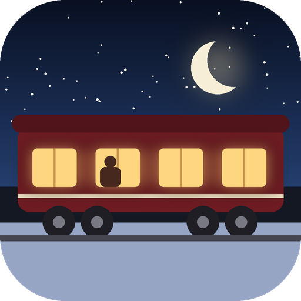
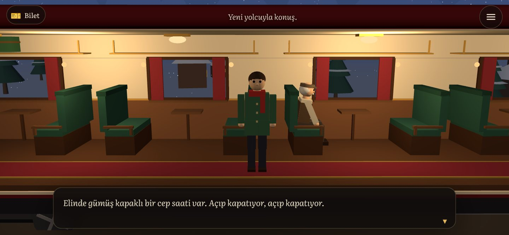
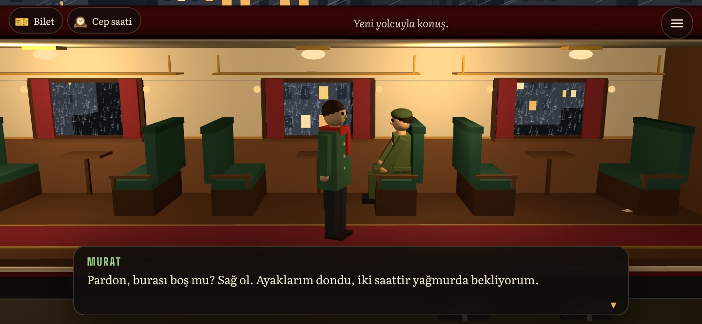
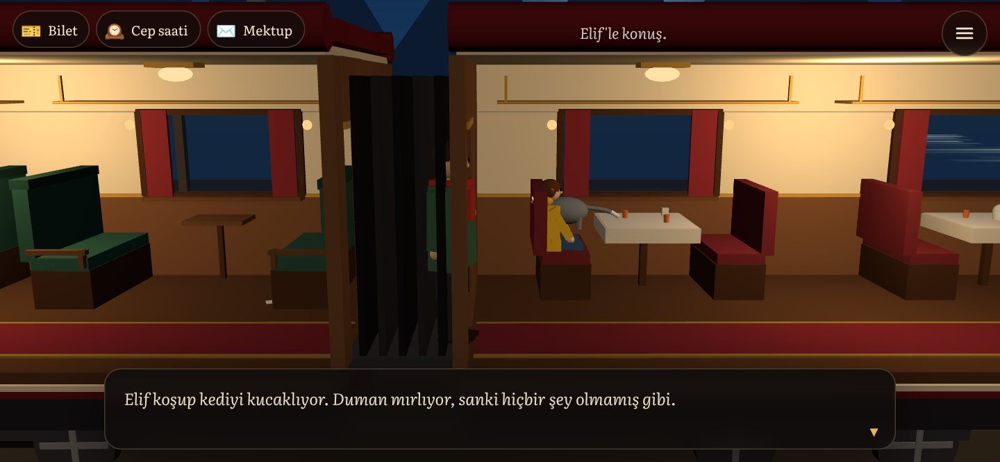
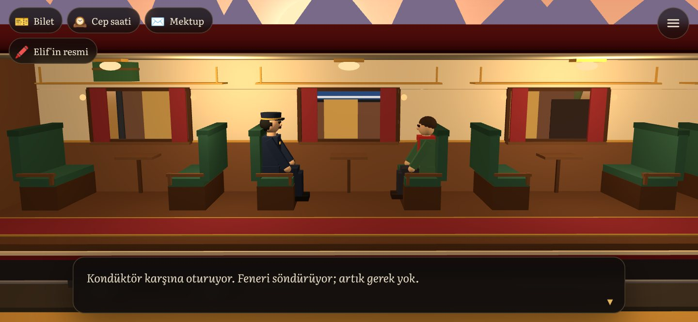

# Son Tren

**Bir gece treninde uyanıyorsun. Nereye gittiğini, kim olduğunu hatırlamıyorsun. Elinde yalnızca varış yeri boş bir bilet var.**

 
 

<!-- ENS:TANITIM -->
<!-- /ENS:TANITIM -->

## Hikâye

Tren karlı ovalardan, yağmurlu bir şehirden ve ay ışığında bir deniz kıyısından geçerek şafağa doğru gidiyor. Her durakta biri biniyor:

| Durak | Saat | Yolcu | Derdi |
|---|---|---|---|
| Ayazlı Ova | 01:12 | **Hüsnü Usta**, yaşlı bir saatçi | Cep saati 04:17'de durmuş, içinden bir çark düşmüş |
| Islak Köprü | 02:40 | **Murat**, yağmurda ıslanmış bir asker | Nişanlısına yazdığı mektubun son cümlesini bulamıyor |
| Mehtap | 03:55 | **Elif**, sarı yağmurluklu küçük bir kız | Kedisi Duman trende kaybolmuş |
| Son Durak | 04:17 | **Kondüktör** | Biletine artık bir şey yazıyor olmalı |

Onlara yardım ettikçe bir şeyler hatırlıyorsun. Ne söylediğin önemli: her yolcuyla yaptığın son konuşma bir anıyı geri getirebilir ya da kaybettirebilir.

- **3 son:** Uyanış, Yarım Hatıra ve Son Durak. Hangisine varacağın hatırladıklarına ve son seçimine bağlı.
- **3 gizli fotoğraf** vagonların köşelerine saklanmış; hepsini bulanlara Uyanış sonunda küçük bir sürpriz var.
- Yaklaşık 20–30 dakikalık, tek oturuşta bitecek bir hikâye. İlerleme kendiliğinden kaydedilir.

## Nasıl oynanır?

- Telefonu **yan çevir**.
- Yürümek için vagonda bir yere, konuşmak ve bakmak için **kişilere ve eşyalara dokun**. Altın renkli işaret sıradaki hedefi gösterir.
- Konuşmayı ilerletmek için ekrana dokun; seçeneklerden birini seç.
- Sol üstteki eşyalara dokunarak onlara yakından bakabilirsin.
- Bilgisayarda: fareyle tıkla, **Boşluk** ile ilerle, **1–3** ile seç, **Esc** ile duraklat.

## Kurulum

**Android:** Yukarıdaki **APK indir** butonuna dokun, dosyayı aç. Telefon ilk seferde "bilinmeyen kaynaklardan yükleme" izni isteyebilir.

**Tarayıcı:** [enskygr234.github.io/Son-Tren](https://enskygr234.github.io/Son-Tren/) adresini aç. Telefonda Chrome menüsünden **Ana ekrana ekle** dersen uygulama gibi tam ekran açılır.

## Teknik

- [three.js](https://threejs.org) ile 3D; her şey koddan üretiliyor, hiç model ya da doku dosyası yok. Vagonlar yüzlerce kutudan tek bir ağa birleştirilerek tek çizimde çiziliyor.
- Tren durur, dünya akar: dışarıdaki ağaçlar, binalar, kar, yağmur ve deniz kameranın etrafında sürekli yeniden kullanılıyor.
- Bütün sesler (ray tıkırtısı, rüzgâr, yağmur, dalgalar, miyav, istasyon zili, müzik) Web Audio ile anında üretiliyor.
- `js/hikaye.js` bütün diyalogları, anıları ve sonları tutar; `js/oyun.js` sahneyi, dokunmayı ve bölüm akışını yönetir.
- Android sürümü [Capacitor](https://capacitorjs.com) ile paketlenir. Her yüklemede GitHub Actions APK'yı derleyip **Releases**'e koyar ve web sürümünü GitHub Pages'te yayınlar.
- Yazı tipleri: [Literata](https://github.com/googlefonts/literata) ve [Big Shoulders](https://github.com/xotypeco/big_shoulders), SIL Open Font License. three.js MIT lisanslıdır.

## Lisans

[MIT](LICENSE) © Enskygr234

<!-- ENS:ALT -->
---

**❄️ ENS Developer'ın diğer projeleri**

🎮 Oyunlar: [Mahalle](https://github.com/Enskygr234/mahalle) · [Ayaz Ata'nın Feneri](https://github.com/Enskygr234/ensdewloper.github.io/tree/main/ayaz-feneri) · [Kayıp Fener](https://github.com/Enskygr234/kayip-fener) · [Son Kış](https://github.com/Enskygr234/son-kis) · [Ayazle](https://github.com/Enskygr234/ayazle) · [Buz Kırıcı](https://github.com/Enskygr234/buz-kirici) · [Kar Birleştir](https://github.com/Enskygr234/kar-birlestir)

[🌐 Bütün projeler](https://enskygr234.github.io/ensdewloper.github.io/) · [👤 GitHub profilim](https://github.com/Enskygr234)

Kış gelir, kod yazılır.

<!-- /ENS:ALT -->
